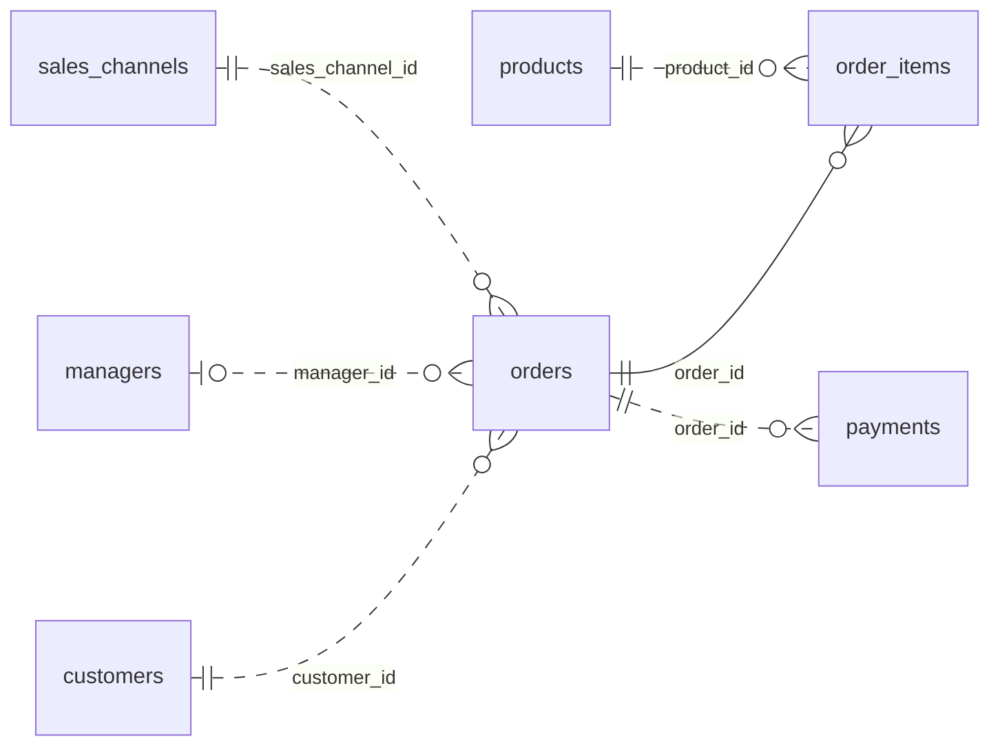

# Fitness Club

Проект построен на примере продаж магазина фитнес-товаров. **Все данные синтетические и предназначены исключительно для учебных целей.**

## Цель проекта

Очистить исходную выгрузку в Excel с помощью Power Query и преобразовать её в набор взаимосвязанных таблиц. На основе этих таблиц создать реляционную базу данных в PostgreSQL, а затем рассчитать показатели продаж SQL-запросами.

## База данных

Скрипты создают локальную базу PostgreSQL `fitness_club_db` и семь связанных таблиц в схеме `public`.

| Скрипт | Что делает |
| --- | --- |
| [`00_create_database.sql`](sql/00_create_database.sql) | Создаёт `fitness_club_db` при подключении к служебной базе `postgres`. |
| [`01_shema.sql`](sql/01_shema.sql) | Создаёт таблицы, ключи и ограничения в новой базе. |

### Связи между таблицами



Позиция заказа определяется парой `order_id` и `line_no`. У заказа может быть несколько позиций и платежей. Поле `manager_id` допускает `NULL`.

## Локальный запуск

Для запуска понадобятся работающий сервер PostgreSQL и клиент `psql`. [Установщики PostgreSQL](https://www.postgresql.org/download/)

Откройте терминал в корне репозитория и выполните команды по очереди.

```sh
psql -X -h localhost -U postgres -d postgres -v ON_ERROR_STOP=1 -f sql/00_create_database.sql
psql -X -h localhost -U postgres -d fitness_club_db -v ON_ERROR_STOP=1 -f sql/01_shema.sql
```

Параметр `-U` задаёт имя вашей локальной роли PostgreSQL. Если сервер запросит пароль, введите пароль этой роли. Если терминал не находит `psql`, добавьте каталог `bin` PostgreSQL в `PATH`.

Эта команда покажет семь созданных таблиц схемы `public`.

```sh
psql -X -h localhost -U postgres -d fitness_club_db -c "\dt public.*"
```

## Загрузка данных

После создания таблиц запустите [`02_load.sql`](sql/02_load.sql) из корня репозитория. Он загружает данные из [семи CSV-файлов](data/data_csv/) в базу `fitness_club_db`.

```sh
psql -X -h localhost -U postgres -d fitness_club_db -f sql/02_load.sql
```

При повторном запуске содержимое семи таблиц полностью заменяется данными из CSV. Очистка и импорт выполняются в одной транзакции, поэтому при ошибке загрузки прежние данные сохраняются.

## Проверки после загрузки

Запустите [`03_checks.sql`](sql/03_checks.sql) в базе `fitness_club_db`.

```sh
psql -X -h localhost -U postgres -d fitness_club_db -v ON_ERROR_STOP=1 -f sql/03_checks.sql
```

В DataGrip можно выполнять проверки по одной. Выберите базу `fitness_club_db`, поставьте курсор внутрь нужного запроса и нажмите **Ctrl+Enter**.

| Проверка | Ожидаемый результат |
| --- | --- |
| Количество строк | `passed = true` для всех семи таблиц. |
| SKU в позициях заказов | Ноль строк с расхождениями между позицией и каталогом. |
| Итоги заказов | `passed = true`, если сумма позиций после скидок вместе с доставкой совпадает с итогом заказа. |
| Платежи | `passed = true`, если сумма платежей совпадает с оплаченной суммой в пределах допуска на округление. |

Ожидаемое количество строк задано для текущих CSV. Если состав выгрузки изменится, обновите эти числа в скрипте проверок.
